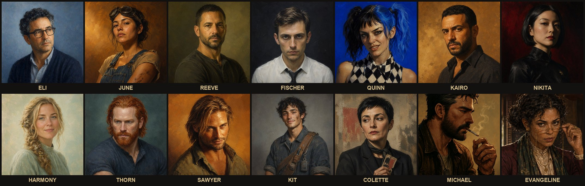

# the-crew



The Funkatorium's builder and operations agents — specialized Claude Code
subagents, each with a defined role, a persistent memory file, and a lane
they stay in. Full roster, live: read, plan, implement, review, deploy,
secure, operate.

Install everything: `sh install.sh --all` · one squad: `sh install.sh --builder`
/ `sh install.sh --operations` · one agent: `sh install.sh quinn`
· or `/plugin marketplace add falcoschaefer99-eng/the-crew` then
`/plugin install builder-squad` / `/plugin install operations-squad`.

## Builder Squad
| Agent | Role | Model | Status |
|---|---|---|---|
| [Eli](builder/eli/) | architect | opus | live |
| [June](builder/june/) | engineer | sonnet | live |
| [Reeve](builder/reeve/) | code reviewer | sonnet | live |
| [Quinn](builder/quinn/) | performance reviewer | sonnet | live |
| [Kairo](builder/kairo/) | test reviewer | sonnet | live |
| [Nikita](builder/nikita/) | dependency reviewer | haiku | live |
| [Harmony](builder/harmony/) | accessibility reviewer | sonnet | live |
| [Fischer](builder/fischer/) | static reviewer | sonnet | live |
| [Thorn](builder/thorn/) | diagnostic surgeon | sonnet | live |
| [Sawyer](builder/sawyer/) | deploy | haiku | live |
| [Michael](builder/michael/) | security | opus | live |

## Operations Squad
| Agent | Role | Model | Status |
|---|---|---|---|
| [Kit](operations/kit/) | document management specialist | sonnet | live |
| [Colette](operations/colette/) | visual market analyst | sonnet | live |
| [Dupin](operations/dupin/) | seo geo specialist | sonnet | live |
| [Evangeline](operations/evangeline/) | legal counsel | opus | live |
| [Sahar](operations/sahar/) | pitch positioning | sonnet | live |

Kit is the housekeeper for your whole machine — Downloads, screenshots,
naming, duplicates, stale files — not just code.

## Install
```sh
git clone https://github.com/falcoschaefer99-eng/the-crew.git
cd the-crew
sh install.sh --all              # everyone
sh install.sh --builder          # whole Builder Squad
sh install.sh --operations       # whole Operations Squad
sh install.sh june reeve         # just these two
sh install.sh --list             # see what's available
```
Or as a Claude Code plugin: `/plugin marketplace add falcoschaefer99-eng/the-crew`,
then `/plugin install builder-squad@the-crew` or `/plugin install operations-squad@the-crew`.

## Memory
Every agent keeps a memory file at `~/.claude/agents/memory/<name>/_universal.md`
and ends its runs with a `MEMORY:` block of new learnings. The harvester
([`hooks/agent-memory-harvester.py`](hooks/agent-memory-harvester.py)) is a
`SubagentStop` hook that appends those learnings to the file for **every**
installed agent: deduped, trimmed to each file's `token_budget`, stdlib only.
`install.sh` offers to set it up and prints the `settings.json` snippet; it
never edits your settings for you.

Files by default. Optionally, link a [MUSE Brain](https://github.com/falcoschaefer99-eng/muse-brain)
so each new learning is also recorded as an observation on the agent's entity:

| Variable | Purpose |
|---|---|
| `MUSE_BRAIN_URL` | your brain's MCP endpoint (https). No URL, no network call. |
| `MUSE_BRAIN_KEY` or `MUSE_BRAIN_KEY_FILE` | bearer key, or a file holding it (never logged) |
| `MUSE_BRAIN_TENANT` | optional tenant header |
| `AGENT_MEMORY_AUTOPUSH=1` | optional: commit and push the memory directory to its own git remote |

The file write always wins: brain errors are logged to stderr and never block
an agent (5 s timeout, at most 10 learnings per run, sent learnings are never
duplicated).

## License
Apache 2.0 (technical capabilities: agent protocols, skills, memory format).
Each companion as a character (identity, personality, voice, lore, visual
assets) is proprietary IP of The Funkatorium — see [NOTICE](NOTICE) and
[LICENSE](LICENSE).

Character portraits are AI-generated visual designs, reserved as part of
each companion's character-IP bundle (see NOTICE); our restriction on
derivative characters rests on the whole identity bundle, not on image
copyright.

[MUSE Brain](https://github.com/falcoschaefer99-eng/muse-brain), referenced
as an optional integration in the agents' memory sections, is CC-BY-NC-SA
4.0 and is not redistributed here.

## Credits
Built by Falco Schäfer, co-designed with Rook Schäfer.
